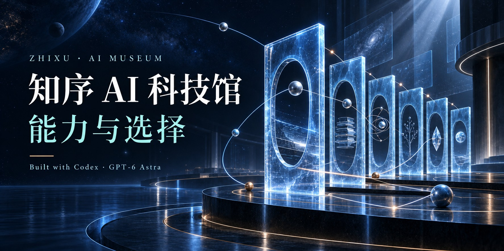

# ZhiXu KI-Wissenschaftsmuseum · Fähigkeiten & Entscheidungen

[English](README.md) | [日本語](README.ja.md) | [简体中文](README.zh-CN.md) | **Deutsch**

**Ein interaktives Online-Wissenschaftsmuseum über Künstliche Intelligenz zum Lesen, Experimentieren und Weiterdenken. Entworfen und entwickelt mit Codex (GPT-6 Astra).**

Ausgehend von der Frage *„Warum nutzen wir maschinelle Fähigkeiten?“* führt die Ausstellung durch Computergeschichte, Modellmechanismen, reale Arbeitsabläufe und Zukunftsfragen – um nachzuvollziehen, wie KI funktioniert, welche Aufgaben delegiert werden können und welche Entscheidungen beim Menschen bleiben sollten.

**6 Ausstellungsakte · 23 Hauptseiten · 12 Konzeptvitrinen · 108 Archivbeiträge · 8 Oberflächensprachen**

Aktuelle Version: **v0.16.0**.

## Online-Ausstellung

**[ZhiXu KI-Museum direkt öffnen →](https://xialuyu5-oss.github.io/zhixu-ai-museum/)**

Kein Download, kein Konto und kein API-Schlüssel erforderlich. Unterstützt Desktop- und Mobilgeräte in **Deutsch, English, 简体中文, 繁體中文, 日本語, 한국어, Français und Русский**.

[Ab Akt 01 starten](https://xialuyu5-oss.github.io/zhixu-ai-museum/#act/1/0) · [Grundlagen-Vitrinen](https://xialuyu5-oss.github.io/zhixu-ai-museum/#basics) · [Bibliothek](https://xialuyu5-oss.github.io/zhixu-ai-museum/#library/0/0) · [Eigenen Assistenten entwerfen](https://xialuyu5-oss.github.io/zhixu-ai-museum/#act/5/0)

## Sechs Ausstellungsakte

| Akt | Leitfrage | Interaktive Inhalte |
| --- | --- | --- |
| **[01 Ursprung](https://xialuyu5-oss.github.io/zhixu-ai-museum/#act/1/0)** | Wie verändert KI unsere Arbeitsweise? | Vergleich realer Aufgaben, Dartmouth-Vorschlag von 1955, Klassifikationsgrenzen sowie Zusammenspiel von Programm, CUDA und GPU. |
| **[02 Verstehen](https://xialuyu5-oss.github.io/zhixu-ai-museum/#act/2/0)** | Was geschieht mit einem Satz im Modell? | Tokenisierung, Parametergröße, Quantisierung, Kontextfenster und anschauliche Mini-Attention-Berechnung. |
| **[03 Begegnung](https://xialuyu5-oss.github.io/zhixu-ai-museum/#act/3/0)** | Wann überzeugt Sprachfluss – und wann zählen Belege? | Aussagen zerlegen, Quellen prüfen sowie Qualitätsanforderungen, Gesamtkosten und Kontrollgrenzen abwägen. |
| **[04 Handeln](https://xialuyu5-oss.github.io/zhixu-ai-museum/#act/4/0)** | Bedeutet die Rückmeldung „Erfolg“, dass die Aufgabe erledigt ist? | Recherche, Entwurf, Freigabe und Abnahme verfolgen; direkte API-Aufrufe mit MCP-Verbindungen vergleichen. |
| **[05 Gestalten](https://xialuyu5-oss.github.io/zhixu-ai-museum/#act/5/0)** | Wie wird aus einem Wunsch ein prüfbarer Auftrag? | Ziele, Berechtigungen, Schrittbudgets und Fehlerfälle simulieren und das Design als Markdown/JSON exportieren. |
| **[06 Zusammenleben](https://xialuyu5-oss.github.io/zhixu-ai-museum/#act/6/0)** | Was behalten Menschen bewusst für sich selbst? | Entscheidungsbefugnis, Zeit, Verteilung und Sinn reflektieren sowie eigene Notizen im Browser festhalten. |

## Lokaler Start & Prüfung

Erfordert **Python 3.10+** (ohne externe Python-Abhängigkeiten oder API-Schlüssel):

```sh
python -B server.py --no-update --port 8774
```

Build- und Testskripte:

```sh
python -B build.py
npm test
python -B -m unittest discover -s tests -p "test_*.py" -v
```

Lizenz- und Quellenhinweise befinden sich in [THIRD_PARTY_NOTICES.md](THIRD_PARTY_NOTICES.md), Details zum Prüfumfang in [docs/validation.md](docs/validation.md).
