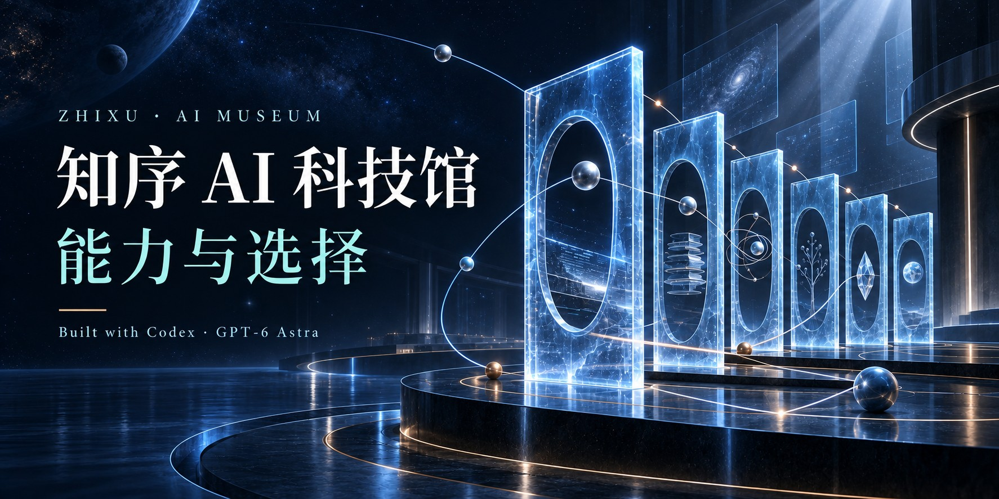
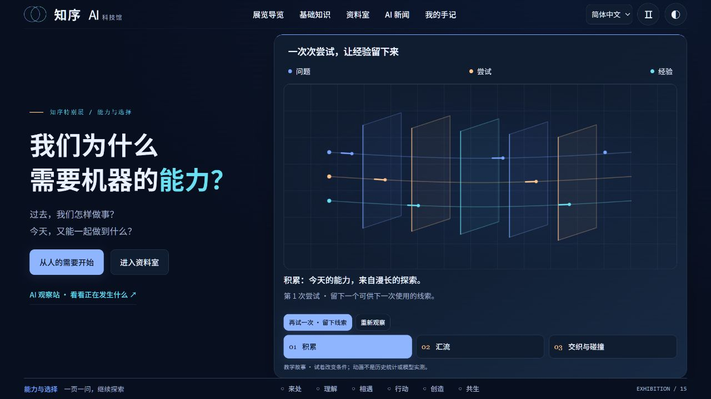
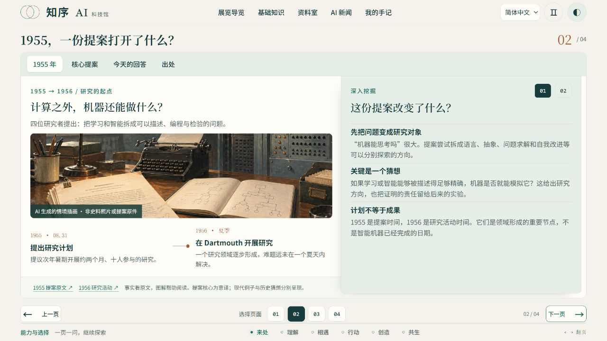

# 知序 AI 科学館 · 能力と選択

[English](README.md) | **日本語** | [简体中文](README.zh-CN.md) | [Deutsch](README.de.md)

**読み、触れ、考えるためのオンライン AI 科学館。Codex（GPT-6 Astra）により設計・開発。**

「なぜ私たちは機械の力を必要とするのか」という問いを出発点に、計算機の歴史・モデルの仕組み・実務タスク・これからの人間の生き方をたどりながら、AI がどのように動き、何を任せることができ、どの選択を人間自身の手に残すべきかを探求します。

**全 6 幕の展示 · 23 のメイン展示ページ · 12 の基礎概念キャビネット · 108 篇のアーカイブ記事 · 8 言語 UI 対応**

現在のバージョン：**v0.16.0**

## オンライン展示

**[知序 AI 科学館へ入る →](https://xialuyu5-oss.github.io/zhixu-ai-museum/)**

ダウンロード・ログイン・API キー設定は一切不要です。PC・スマートフォンの両方に対応し、画面上から **日本語・English・简体中文・繁體中文・한국어・Deutsch・Français・Русский** の 8 言語に切り替え可能です。

[第 1 幕から始める](https://xialuyu5-oss.github.io/zhixu-ai-museum/#act/1/0) · [基礎概念キャビネット](https://xialuyu5-oss.github.io/zhixu-ai-museum/#basics) · [資料室へ](https://xialuyu5-oss.github.io/zhixu-ai-museum/#library/0/0) · [アシスタントを設計する](https://xialuyu5-oss.github.io/zhixu-ai-museum/#act/5/0)

## 全 6 幕の展示構成

| 展示幕 | 中心となる問い | 体験できるインタラクティブ展示 |
| --- | --- | --- |
| **[01 起源](https://xialuyu5-oss.github.io/zhixu-ai-museum/#act/1/0)** · どこから来たのか | AI 時代において、仕事の進め方はどう変わったか？ | 議事録整理・外国語読解・障害切り分けの比較、1955 年ダートマス提案書の読解、分類境界と CPU/CUDA/GPU の役割分担。 |
| **[02 理解](https://xialuyu5-oss.github.io/zhixu-ai-museum/#act/2/0)** · どう応答するのか | 一文がモデルに入力された後、内部で何が起きているのか？ | トークン分割、パラメータ規模・量子化・コンテキスト窓の観察、マイクロ Attention 計算の可視化。 |
| **[03 対峙](https://xialuyu5-oss.github.io/zhixu-ai-museum/#act/3/0)** · 何を任せるのか | 流暢な回答はそのまま信頼できるのか？最大モデルが常に最適か？ | 主張の分解と根拠照合、品質基準・トータルコスト・制御境界のトレードオフ比較。 |
| **[04 行動](https://xialuyu5-oss.github.io/zhixu-ai-museum/#act/4/0)** · 応答から実行へ | ツールが「成功」と返せば、タスクは本当に完了したと言えるか？ | 調査・起案・承認・検収の一連の追跡、直接 API と MCP 接続の比較、権限と結果検証の分離。 |
| **[05 創造](https://xialuyu5-oss.github.io/zhixu-ai-museum/#act/5/0)** · アシスタント設計 | 曖昧な要望を、実行・検証可能なタスク仕様へどう落とし込むか？ | 目標と完了条件の定義、権限・ステップ上限の設定、障害注入と再開テスト、Markdown/JSON 仕様エクスポート。 |
| **[06 共生](https://xialuyu5-oss.github.io/zhixu-ai-museum/#act/6/0)** · どこへ向かうのか | 機械がより多くを担う時代に、人は何を自分の手に残すのか？ | 決定権・時間・分配・意味をめぐる考察と、ブラウザ内フィールドノートの記録。 |

## 画面プレビュー





## ローカル起動・検証

**Python 3.10 以上**（標準ライブラリのみ、外部パッケージや API キー不要）で動作します。

```sh
python -B server.py --no-update --port 8774
```

ビルドおよび自動検証スイート：

```sh
python -B build.py
npm test
python -B -m unittest discover -s tests -p "test_*.py" -v
```

フォントライセンスおよび出典については [THIRD_PARTY_NOTICES.md](THIRD_PARTY_NOTICES.md)、検証範囲については [docs/validation.md](docs/validation.md) を参照してください。
