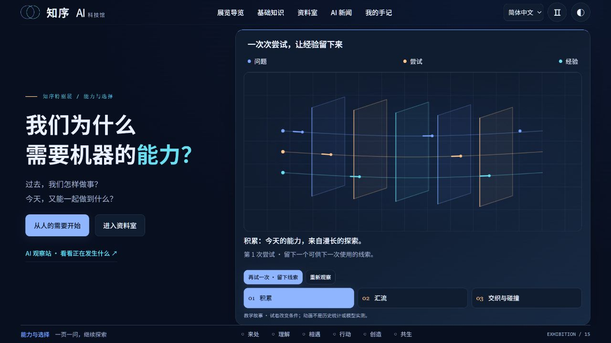

# ZhiXu AI Science Museum · Capabilities & Choices

**English** | [日本語](README.ja.md) | [简体中文](README.zh-CN.md) | [Deutsch](README.de.md)

**An interactive online AI science museum for reading, hands-on experimentation, and critical reflection. Designed and built with Codex (GPT-6 Astra).**

Starting from *"Why do we turn to machine capabilities?"*, the exhibition walks through computing history, model mechanics, real-world workflows, and future human life—helping visitors examine how AI works, what tasks can be delegated to it, and which choices remain irreducibly human.

**6 Exhibition Acts · 23 Main Pages · 12 Core Concept Cabinets · 108 Archival Articles · 8 UI Languages**

Current version: **v0.16.0**.

## Live Exhibition

**[Enter ZhiXu AI Science Museum →](https://xialuyu5-oss.github.io/zhixu-ai-museum/)**

No download, sign-in, or API key required. Responsive across desktop and mobile browsers (supports **English, 简体中文, 繁體中文, 日本語, 한국어, Deutsch, Français, Русский** via the in-app language switcher).

[Start at Act 01](https://xialuyu5-oss.github.io/zhixu-ai-museum/#act/1/0) · [Core Concept Cabinets](https://xialuyu5-oss.github.io/zhixu-ai-museum/#basics) · [Research Library](https://xialuyu5-oss.github.io/zhixu-ai-museum/#library/0/0) · [Design Your Own Agent](https://xialuyu5-oss.github.io/zhixu-ai-museum/#act/5/0)

## Why This Museum Exists

AI now sits inside writing, learning, software engineering, and daily decision-making. What we usually see is a fluent answer, a polished demo, or a benchmark score. Understanding AI requires asking what happens underneath: *How was this output produced? Does the evidence actually support the claim? Did the tool genuinely finish the job?*

ZhiXu turns those questions into an interactive trail: read a primary source, perturb a parameter, inspect the outcome, and test your mental model. Historical proposals, visual diagrams, interactive micro-labs, and cited sources converge in one space—closing with an open reflection on meaning, agency, and human life when material scarcity recedes.

## Six Exhibition Acts

| Act | Guiding Question | Interactive Exhibits |
| --- | --- | --- |
| **[01 Origins](https://xialuyu5-oss.github.io/zhixu-ai-museum/#act/1/0)** · Where It Came From | How has our way of working shifted in the AI era? | Compare meeting synthesis, foreign-language reading, and fault triage; inspect the 1955 Dartmouth proposal; explore classification boundaries and CPU/CUDA/GPU division of labor. |
| **[02 Understanding](https://xialuyu5-oss.github.io/zhixu-ai-museum/#act/2/0)** · How It Responds | What happens after a prompt enters a model? | Tokenize text, inspect parameter scale, quantization, and context windows, and trace a micro-attention computation. |
| **[03 Encounter](https://xialuyu5-oss.github.io/zhixu-ai-museum/#act/3/0)** · What to Delegate | Does fluency imply truth? Is the largest model always right for the job? | Decompose claims, verify citations, and weigh quality thresholds, end-to-end cost, and control boundaries. |
| **[04 Action](https://xialuyu5-oss.github.io/zhixu-ai-museum/#act/4/0)** · From Answers to Actions | When a tool reports "success," is the task actually done? | Trace retrieval, drafting, human approval, and verification; compare direct APIs vs. MCP connections, permissions, and outcome checks. |
| **[05 Creation](https://xialuyu5-oss.github.io/zhixu-ai-museum/#act/5/0)** · Design Your Assistant | How do you turn a vague wish into an auditable workflow? | Define goals and completion criteria, select evidence, configure permissions and step budgets, inject faults, and export your agent spec as Markdown/JSON. |
| **[06 Coexistence](https://xialuyu5-oss.github.io/zhixu-ai-museum/#act/6/0)** · Where We Go Next | As machines do more, what do humans choose to keep? | Examine decision authority, time, distribution, and purpose—and record your own field notes. |

## Hands-On Micro-Labs

| Lab | What You Control | What to Observe |
| --- | --- | --- |
| **Samples & Decision Boundaries** | Shift classification thresholds and add boundary training samples. | Why can 100% training accuracy still misclassify unseen parts? |
| **Tokens & Text Representation** | Enter multilingual strings to inspect tokenization and IDs. | Why doesn't one token always match one word or character? |
| **Parameters & Quantization** | Vary parameter counts and numerical precision. | How does memory footprint scale, and why doesn't size alone equal capability? |
| **Context & Attention** | Modify context items and inspect micro-attention weights. | Does fitting inside the context window guarantee effective recall? |
| **Parallel Compute** | Adjust task scheduling and parallelism constraints. | Which operations parallelize cleanly and which remain sequential bottlenecks? |
| **Evidence & Model Selection** | Toggle quality gates and cost constraints; rewrite unsupported claims. | Which statements are grounded in evidence, and what is the true total cost? |
| **Tool Execution & Fault Injection** | Configure read/write scopes, approval gates, and simulated tool failures. | Where does an agent advance, block on policy, or halt safely? |

*Note: All micro-labs use deterministic browser-side pedagogical models rather than live LLM calls or production benchmarks.*

## Visual Preview

**Prologue Hall · Starting from Human Needs**



**Main Gallery · From the 1955 Proposal to Modern Questions**


## Local Quickstart

Requires **Python 3.10+** (standard library only; no third-party Python packages or API keys required).

```sh
python -B server.py --no-update --port 8774
```

Open `http://127.0.0.1:8774`. On Windows, you can also run `start-local.cmd`. Root `index.html` works as a standalone offline bundle, while `deploy/site/` contains the static multi-file build.

## Build & Verification

```sh
python -B build.py
npm test
python -B -m unittest discover -s tests -p "test_*.py" -v
```

## Repository Layout

| Path | Purpose |
| --- | --- |
| `src/` | Editable exhibition pages, interactive widgets, styles, and 8-language catalogs |
| `assets/` | Illustrations, subset local fonts, licenses, and provenance manifests |
| `data/` | News snapshots, source verifications, and translations |
| `tools/` | News processing, i18n maintenance, font subsetting, and packaging scripts |
| `tests/` | State-machine, build, data, and browser verification suites |
| `build.py` | Generates standalone offline HTML and `deploy/site/` static output |
| `server.py` | Localhost-only preview server |

## Notices & Scope

See [THIRD_PARTY_NOTICES.md](THIRD_PARTY_NOTICES.md) for font licenses and source attributions, and [docs/validation.md](docs/validation.md) for verification scope.
